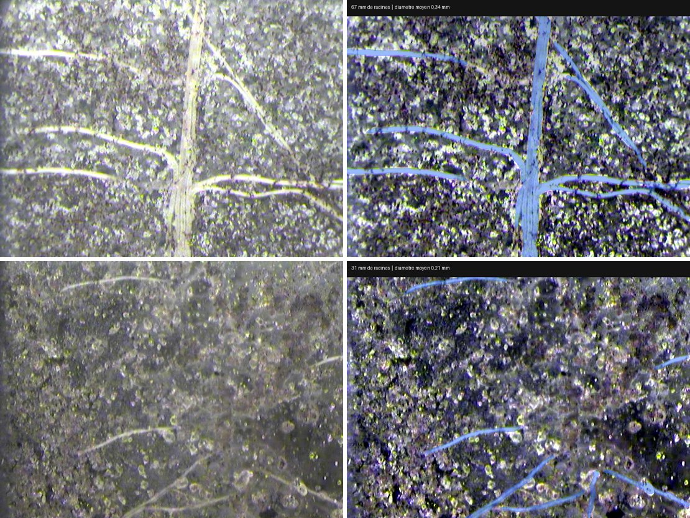

# Root Segmentator

[](https://github.com/ffaramus/rootseg/actions/workflows/tests.yml)
[](https://github.com/ffaramus/rootseg/actions/workflows/docker.yml)

> **In English.** Root Segmentator detects plant roots in minirhizotron images (peanut, public PRMI dataset) and
> measures their length, diameter and root length intensity in millimetres, per image and per tube, date and depth.
> Command line tool, REST API, Docker image and online demo; evaluated once on unseen tubes (median Dice 0.74 to 0.79).

**Mesurer les racines sur des images de minirhizotron, automatiquement et en millimètres.** Un minirhizotron photographie
les racines contre la paroi d'un tube enfoncé dans le sol, des milliers d'images par saison ; les annoter à la main
prend des semaines. Root Segmentator repère les racines sur chaque image et en donne la longueur, le diamètre et
l'intensité racinaire, par image et par tube, date et profondeur.

**[Essayer la démo en ligne](https://rootseg.streamlit.app)** (déposer une image, voir les racines et les mesures ; la
démo gratuite met environ une minute à se réveiller).



## Résultats

Évalué une seule fois sur des **tubes jamais vus** pendant le développement (jeu de test public PRMI, arachide) :

| | Test corrigé à la main (50 images) | Grand test (4 743 images) | Autre caméra (3 542 images) |
|---|---|---|---|
| Dice médian par image | 0,79 | 0,74 | 0,79 |
| Racines trouvées | 80 % | 67 % | 85 % |
| Images sans racine faussement détectées | 0 % | 13 % | 20 % |

- **Mesures** (test corrigé) : longueur totale à 7,5 % près après étalonnage (23 % sous-estimée en brut : racines fines
  non détectées) ; diamètre juste à quelques % près au-dessus de 0,25 mm, surestimé pour les racines plus fines.
- **Vitesse** : environ 360 images par minute sur le processeur d'un ordinateur portable, sans GPU, lecture et écriture
  comprises.
- **Positionnement** : du même ordre que le Dice moyen de 0,773 publié sur ce même jeu (arachide PRMI, mêmes découpages
  de 11 485, 3 347 et 4 793 images), moyenne des modèles comparés dans Smith et al., *A systematic comparison of
  transformers and ConvNets for root segmentation across nine datasets*, Plant Methods 22, 52 (2026),
  [doi:10.1186/s13007-026-01533-6](https://doi.org/10.1186/s13007-026-01533-6), tables 4 et 5. Pas directement
  comparable : leur référence est l'annotation d'origine et la façon de moyenner le Dice n'est pas la même.

## Utilisation

```bash
pip install -r requirements-cpu.txt      # PyTorch en version CPU
pip install -e ".[api]"
rootseg examples/images resultats/       # masques, superpositions, mesures_images.csv, mesures_tubes.csv
```

Les fichiers du modèle (20 Mo) se téléchargent au premier lancement depuis la
[release v1.1](https://github.com/ffaramus/rootseg/releases/tag/v1.1).

**API web** : `rootseg-api`, puis la documentation interactive sur http://localhost:8000/docs (`/predict` : une image
en entrée, les mesures en JSON en sortie).

**Docker**, sans rien installer d'autre :

```bash
docker run -p 8000:8000 ghcr.io/ffaramus/rootseg                                       # API
docker run -v "$PWD":/donnees ghcr.io/ffaramus/rootseg rootseg /donnees/images /donnees/resultats
```

## Méthode

Le cœur du projet est la **qualité des données** : les annotations publiques de PRMI sont tracées en chaînes de
rectangles, avec des décalages, des fentes et des racines oubliées.

1. **Diagnostic des annotations** et correction à la main de 273 images (QuPath), pour l'entraînement, la validation
   et un test fiable.
2. **Comblement automatique des fentes** entre rectangles, validé contre les corrections manuelles.
3. **U-Net** à encodeur EfficientNet-B0 pré-entraîné, entraîné sur 11 485 images : plus d'images, même mal annotées,
   ont plus apporté que de meilleures annotations sur un petit lot.
4. **Classifieur des taches prédites** (gradient boosting) qui retire les fausses détections sans réentraîner le U-Net.
5. **Échelle vérifiée sur les données** : le « 150 DPI » des métadonnées est faux d'un facteur 7 ; l'échelle réelle
   (40,9 px/mm) se déduit du pas de la caméra le long du tube.

Le raisonnement complet est dans les notebooks, à lire dans l'ordre :

| Notebook | Contenu |
|---|---|
| [01](notebooks/01_caracteristiques_images.ipynb), [02](notebooks/02_pretraitements.ipynb) | caractéristiques des images et prétraitement |
| [A1](notebooks/A1_pool_annotation.ipynb), [A2](notebooks/A2_comblement_fentes.ipynb) | images à corriger, comblement des fentes |
| [03](notebooks/03_premier_entrainement.ipynb) à [05](notebooks/05_entrainement_train_complet.ipynb) | entraînements : 149, 1 000 puis 11 485 images |
| [E1](notebooks/E1_masques_origine.ipynb) à [E4](notebooks/E4_filtre_taches.ipynb), [06](notebooks/06_entrainement_occlusion.ipynb) | essais : annotations d'origine, augmentations, clDice, occlusion, classifieur des taches |
| [A3](notebooks/A3_echelle_et_mesures.ipynb) | vérification de l'échelle et mesure des traits |
| [07](notebooks/07_evaluation_test.ipynb) | évaluation finale sur le test |

Code : `src/prmi/` (inférence : `inference.py`, `cli.py`, `api.py` ; mesures : `traits.py`). Tests : `tests/`
(lancés à chaque push). Fiche du modèle : [MODEL_CARD.md](MODEL_CARD.md).

## Limites

- **Racines fines ou peu visibles** : une partie n'est pas détectée, d'où une longueur sous-estimée image par image ; la
  longueur étalonnée vaut pour des totaux (par tube, par date), pas pour une image seule.
- **Diamètre des racines très fines** (moins de 0,25 mm environ) surestimé : le modèle travaille à demi-résolution.
- **Images presque vides** : quelques fragments de racine isolés peuvent être retirés avec les fausses détections.
- **Domaine** : arachide, caméras du jeu PRMI (736 x 552 et 640 x 480 px). D'autres espèces ou caméras demanderaient
  une vérification, et un réglage de l'échelle (`--px-par-mm`).
- **Profondeur** estimée à partir de la position le long du tube (tube à 45 degrés, pas de 13,5 mm).
- Un seul annotateur pour les corrections manuelles ; l'annotation humaine elle-même manque des racines faibles.

## Données et crédits

Images : PRMI, *Plant Root Minirhizotron Imagery* (W. Xu, G. Yu, Y. Cui, R. Gloaguen, A. Zare et al., 2022),
[Dryad](https://datadryad.org/dataset/doi:10.5061/dryad.2v6wwpzp4), licence CC0.

Projet de François Faramus, data scientist, analyse d'images du vivant.
