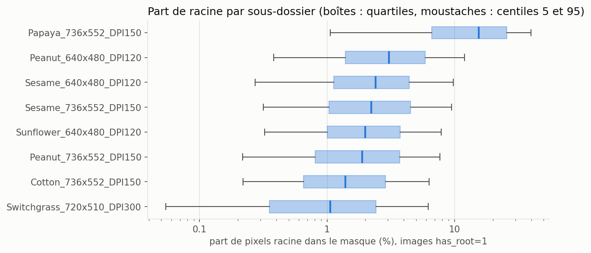
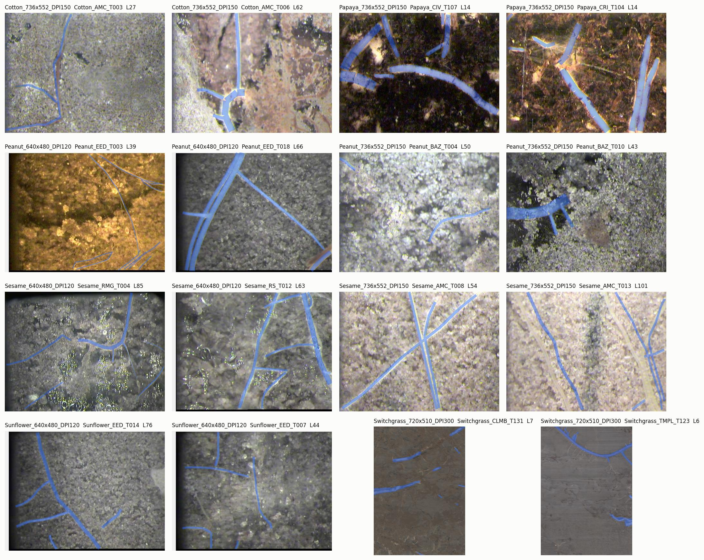
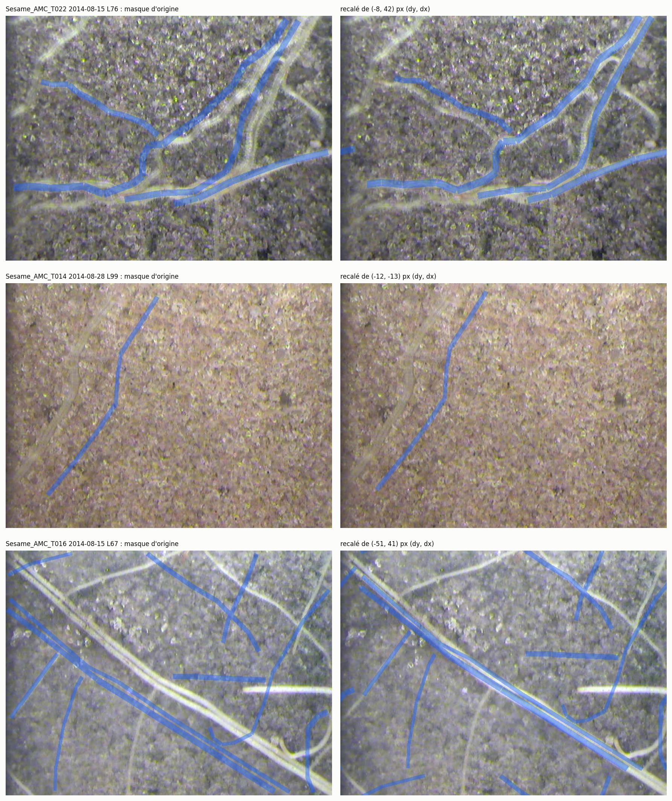
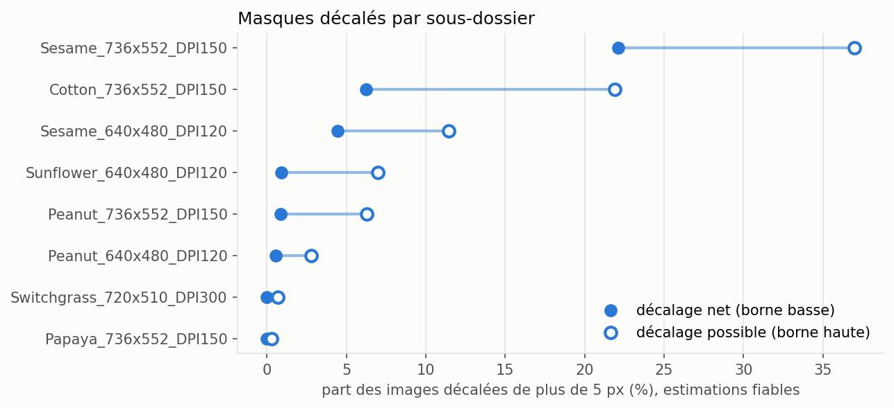
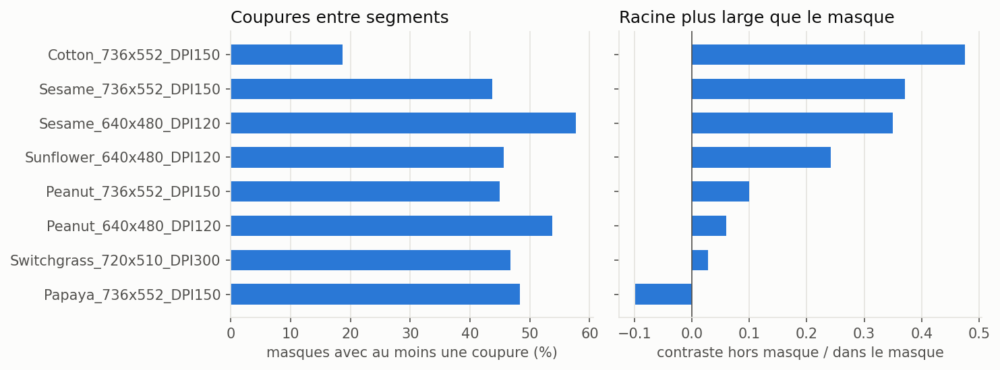
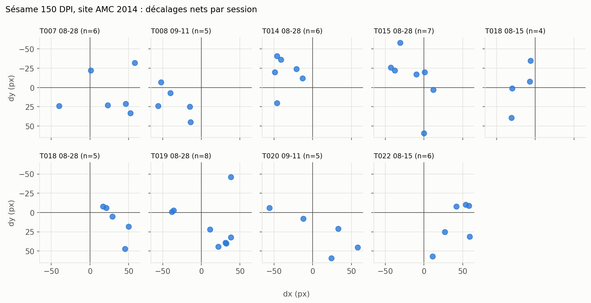

# Exploration et diagnostic des masques PRMI

Synthèse de la phase 1 : structure du jeu PRMI, inventaire, qualité des masques par espèce,
et choix de l'espèce de travail.
Code : [`src/prmi/`](../src/prmi/). Les notebooks d'exploration de cette phase
(`01_inventaire`, `02_diagnostic_masques`) ont été retirés du dépôt et restent dans l'historique git
(commit `f68c3bb`).

## En bref

- Le jeu contient 72 568 images de 6 espèces, dont 63 943 avec masque. Les splits officiels
  sont disjoints par tube : le test officiel est déjà un jeu de « tubes jamais vus ».
- **Le décalage des masques est réel dans les fichiers originaux** : il ne vient pas de la
  conversion Dataset Ninja. Il est concentré sur le sésame 150 DPI, site AMC, campagne 2014
  (22 à 37 % des images, environ 47 px), et touche aussi le coton (6 à 22 %).
- Il **n'est pas constant** par tube ni par session, et il peut différer d'une racine à l'autre
  dans une même image : un recalage automatique global ne suffira pas.
- Les fentes entre rectangles sont fréquentes (environ la moitié des masques) mais faciles à
  combler. Les masques sont plus étroits que les racines pour le coton, le sésame et le tournesol.
- **Recommandation : l'arachide 150 DPI comme espèce de travail.** Le décalage y est rare, les
  masques couvrent la largeur des racines, et c'est le sous-dossier le plus fourni.

## 1. Le jeu de données

Archive officielle Dryad `PRMI_official` (README du 27 août 2021, CC0), extraite sur la clé USB.
Sa structure est conforme au README :

- `train/`, `val/`, `test/`, chacun avec `images/`, `masks_pixel_gt/` et `labels_image_gt/` ;
- un sous-dossier par espèce et capteur, par exemple `Peanut_736x552_DPI150` ;
- images JPEG RGB (PNG pour le switchgrass), masques PNG RGBA binaires (R = G = B dans {0, 255},
  alpha constant) nommés `GT_` + nom de l'image ;
- nom d'image : `Espèce_T<tube>_L<position>_<AAAA.MM.JJ>_<HHMMSS>_<site>_DPI<dpi>[_<ligne>_<colonne>]`.
  Le code en majuscules est le site, pas un opérateur. Le suffixe ligne/colonne du switchgrass
  indique des tuiles découpées dans des images plus grandes ;
- un JSON par sous-dossier et par split, avec un enregistrement par image : `image_name`, `crop`,
  `has_root`, `binary_mask`, `location`, `tube_num`, `date`, `depth`, `dpi`
  (plus `row_idx`, `col_idx` pour le switchgrass).

Points d'attention relevés :

- le README indique que les masques ont été « tracés à la main dans WinRHIZO Tron puis
  reconstruits », sans contrôle qualité décrit ;
- le champ `binary_mask` vaut `N/A` pour 38 tuiles switchgrass du val alors que le masque existe :
  le nom du masque est dérivé du nom de l'image ;
- `has_root` est fiable : aucun masque non vide sur 200 images `has_root = 0` contrôlées, un seul
  masque vide parmi les 35 552 images `has_root = 1` ;
- un numéro de tube n'est unique qu'au sein d'une espèce et d'un site. Les numéros des tubes BAZ
  de l'arachide reviennent en 2015 et en 2016, sans qu'on sache s'il s'agit des mêmes tubes.

## 2. Inventaire

Une ligne par image dans `data/interim/inventory.parquet` (un seul parcours de la clé, 36 s).

| Sous-dossier | Images | Avec racine | Tubes train/val/test | Dates par tube et position (médiane, max) | Part de racine (médiane) |
|---|---:|---:|---|---|---:|
| Cotton 736x552 DPI150 | 2 412 | 918 | 7/2/3 | 3 (3) | 1,4 % |
| Papaya 736x552 DPI150 | 546 | 487 | 6/2/3 | 1 (7) | 15,5 % |
| Peanut 640x480 DPI120 | 17 042 | 8 508 | 19/6/7 | 5 (6) | 3,1 % |
| **Peanut 736x552 DPI150** | **19 625** | **11 147** | **28/8/12** | **4 (7)** | **1,9 %** |
| Sesame 640x480 DPI120 | 2 160 | 1 460 | 10/5/4 | 1 (4) | 2,4 % |
| Sesame 736x552 DPI150 | 14 346 | 7 923 | 24/7/9 | 5 (7) | 2,2 % |
| Sunflower 640x480 DPI120 | 3 900 | 1 646 | 9/3/4 | 2 (4) | 2,0 % |
| Switchgrass 720x510 DPI300 | 3 912 | 3 463 | 25/6/19 | 1 (2) | 1,1 % |
| Switchgrass, sans masque | 8 625 | sans objet | 57/0/0 | | |

Les dates sont comptées par saison (année). Un seul tube switchgrass est commun au train et au
test ; tous les autres splits sont disjoints par tube.



## 3. Diagnostic des masques

### Superpositions sur les fichiers originaux



Les masques sont des chaînes de rectangles pleins. Sur les fichiers de la clé, on voit sans
ambiguïté des masques décalés (sésame AMC 2014), des fentes entre rectangles, des rectangles plus
étroits que la racine, des racines visibles non annotées (coton, papaye, tournesol) et quelques
masques posés là où aucune racine n'est visible.



### Indicateurs

Calculés sur un échantillon de 2 925 images avec racine (jusqu'à 40 sessions tube et date par
sous-dossier, 10 images par session) :

- **décalage** : translation du masque (jusqu'à 60 px dans chaque direction) qui maximise le
  contraste local sous le masque. *Net* si le gain de score est d'au moins 2,5, *possible* s'il est
  d'au moins 1 ; seules les estimations jugées fiables comptent (75 à 98 % des images) ;
- **coupures** : fentes reliées par une fermeture morphologique de 2 px ;
- **débord** : contraste juste à l'extérieur du masque rapporté au contraste à l'intérieur, sur les
  images bien alignées. Proche de 0 : le masque couvre la racine ; élevé : la racine dépasse.

| Sous-dossier | Décalage net / possible | Amplitude médiane (net) | Masques avec coupure | Débord |
|---|---|---:|---:|---:|
| Sesame 736x552 DPI150 | **22 % / 37 %** | 47 px | 44 % | 0,37 |
| Cotton 736x552 DPI150 | 6 % / 22 % | 20 px | 19 % | 0,48 |
| Sesame 640x480 DPI120 | 4 % / 11 % | 22 px | 58 % | 0,35 |
| Sunflower 640x480 DPI120 | 1 % / 7 % | | 46 % | 0,24 |
| **Peanut 736x552 DPI150** | **1 % / 6 %** | | **45 %** | **0,10** |
| Peanut 640x480 DPI120 | 1 % / 3 % | | 54 % | 0,06 |
| Switchgrass 720x510 DPI300 | 0 % / 1 % | | 47 % | 0,03 |
| Papaya 736x552 DPI150 | 0 % / 0 % | | 48 % | -0,10 |

Les petits trous à l'intérieur des masques sont négligeables partout (0,1 à 0,3 % de la surface).
L'amplitude n'est pas donnée quand le décalage net ne concerne que 2 ou 3 images (arachide,
tournesol).





Ces résultats concordent avec les défauts signalés par le benchmark *Plant Methods* (2026) sur le
sésame et le coton.

### Le décalage est-il constant ?

Non.

- Il dépend de la campagne : 26 % de décalages nets au site AMC en 2014, 0 % au site BCC en 2012
  pour le même sous-dossier de sésame.
- Dans une session (tube et date) du sésame 150 DPI qui contient des images décalées, seul un
  quart des images l'est en médiane, avec des directions variées (écarts-types de 15 à 45 px).
- Dans une même image, les racines ne sont pas toujours décalées de la même façon : la
  translation unique estimée ici en réaligne souvent une partie seulement.



Un recalage automatique par tube ou par session est donc exclu. Un recalage par racine serait
possible en principe, mais délicat : un segment droit peut glisser le long de son axe sans que le
score change, les petits segments donnent des estimations instables, et les racines sombres
trompent le critère de contraste.

### Limites

- L'estimateur de décalage suppose une translation unique par image et des racines plus claires
  que le sol ; il se trompe souvent sur les racines sombres.
- Le contrôle visuel est sommaire : 24 images, un seul relecteur, planches à résolution réduite,
  jugement global par image et non racine par racine. Sur 18 décalages « possibles », 5 recalages
  étaient justes, 6 faux (tous avec un gain d'au plus 2,0), 7 indécidables ; les 6 images
  « alignées » contrôlées l'étaient bien. Les seuils sont calés sur ces seules images : les taux
  sont des ordres de grandeur, à reprendre avec un protocole racine par racine.
- Le débord peut être gonflé par les poils absorbants (sésame).
- Les racines visibles non annotées ne sont pas quantifiées.

## 4. Recommandation : l'arachide 150 DPI

**Espèce de travail : `Peanut_736x552_DPI150`.**

- **Qualité des masques** : décalage net de 1 % (6 % au plus en comptant les fausses alertes),
  masques qui couvrent la largeur des racines (débord de 0,10), ce qui compte directement pour le
  diamètre. Les fentes entre rectangles sont le principal défaut, et le plus simple à corriger.
- **Volume** : le sous-dossier le plus fourni, avec 19 625 images dont 11 147 avec racine, et
  48 tubes répartis entre train (28), val (8) et test (12).
- **Séries temporelles** : jusqu'à 7 dates par tube et position sur une saison (médiane 4), sur
  deux sites (BAZ en 2015 et 2016, CZ en 2016).
- **Jeu de test** : les 12 tubes du test officiel, jamais vus à l'entraînement, suffisent pour
  tirer les 50 images de test propres.

Points de vigilance : la racine n'occupe que 1,9 % des pixels en médiane (fort déséquilibre de
classes), une partie des racines sont sombres, et les tubes CZ n'ont qu'une date.

**Deuxième espèce, optionnelle : l'arachide 120 DPI** (`Peanut_640x480_DPI120`, site EED 2017).
Ses masques sont aussi propres (décalage net de 1 %, débord de 0,06) ; même espèce, autre capteur
et autre site, elle permettrait de tester la généralisation d'un capteur à l'autre. À décider
après les premiers entraînements.

Écartées :

- **sésame 150 DPI** : décalage massif sur la campagne AMC 2014 et masques trop étroits. Il reste
  un résultat du diagnostic, utile pour illustrer les défauts ;
- **coton** : décalage fréquent et masques les plus étroits ;
- **sésame 120 DPI, tournesol** : masques trop étroits, peu d'images (2 160 et 3 900) ;
- **papaye** : 546 images seulement ;
- **switchgrass** : masques propres, mais tuiles à 300 DPI, peu de dates par position, et des
  racines très fines, éloignées des autres espèces.

## 5. Conséquences pour la phase 2 (propositions)

- **Pas de recalage automatique du décalage** : sur l'arachide 150 DPI il est rare, et les
  décalages variables d'une racine à l'autre le rendent peu fiable. L'indicateur sert plutôt de
  **filtre** : les images en « décalage possible » sont écartées de l'entraînement sur masques
  d'origine.
- **Correction automatique limitée à ce qui est fiable** : comblement des fentes entre rectangles.
- **Correction manuelle** des 100 à 150 images d'entraînement et des 50 images de test, dans
  RootPainter ou Label Studio, en partant des masques existants.
- Le recalage racine par racine irait dans les « Idées de côté » du cadrage.

## Reproduire

Depuis la racine du projet, dans l'environnement `dl2`, clé USB branchée :

```bash
python src/prmi/inventory.py                   # data/interim/inventory.parquet (environ 40 s)
PYTHONPATH=src python -m prmi.diagnostic       # data/interim/mask_diagnostic.parquet (environ 1 min)
```

Les notebooks d'origine se récupèrent avec
`git show f68c3bb:notebooks/02_diagnostic_masques.ipynb > 02_diagnostic_masques.ipynb` ; ils ne
lisent que ces caches (sauf pour les images affichées).
